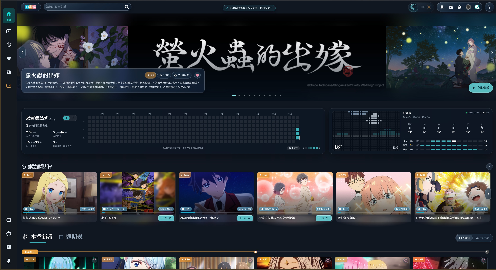

# 動畫瘋重製版 3.0

[下載安裝包 (Releases)](https://github.com/aunight/Anigamer-Redesign3.0/releases/latest) · [Userscript 直接安裝](https://raw.githubusercontent.com/aunight/Anigamer-Redesign3.0/main/userscript/ani-ambilight.user.js) · [附加腳本批次安裝](https://htmlpreview.github.io/?https://raw.githubusercontent.com/aunight/Anigamer-Redesign3.0/main/docs/plugins.html) · [問題回報 (Issues)](https://github.com/aunight/Anigamer-Redesign3.0/issues)

[](https://github.com/aunight/Anigamer-Redesign3.0/releases/latest)


[](https://github.com/aunight/Anigamer-Redesign3.0/actions/workflows/ci.yml)
[](LICENSE)
[](#授權聲明license)



由 [秋夜](https://www.aunight.pw) 主導的 **動畫瘋重製版 3.0** —— 以現代化磨砂玻璃（Frosted Glass）、高對比電影級排版與全頁視覺一致性為核心，重製動畫瘋首頁（含開場液態波紋、主視覺橫幅、動畫瘋足跡熱力圖＆點陣天氣實況）、播放頁、播放器控制列、片庫目錄與第三方輔助腳本整合體驗。

> [!NOTE]
> 本版本仍在測試與調整中，有任何問題歡迎[提 Issue](https://github.com/aunight/Anigamer-Redesign3.0/issues)。

> **上游專案與開源致謝 / Upstream & Credits**  
> - **動態環境光引擎（WebGL 2 / Canvas）與基礎設定框架**：改作自原專案 **[Hinataragi/anigamer-ambilight](https://github.com/Hinataragi/anigamer-ambilight)**（MIT 授權），並承襲其參考自 [youtube-ambilight](https://github.com/WesselKroos/youtube-ambilight) 與 [bilibili-ambilight](https://github.com/iceorange-dev/bilibili-ambilight) 的取樣技術。  
> - **首頁足跡熱力圖＆點陣天氣卡片**：移植並適配自 **[jiuyang5354/bilibili-margin](https://github.com/jiuyang5354/bilibili-margin)**（MIT 授權，含來自 21st `vijayksingh` 的點陣天氣天空概念），可於「一般」設定中獨立開關顯示，並支援動畫瘋觀影紀錄補全與即時天時統計。  
> - **開場液態波紋著色器背景**：改寫自 **[Saurabh-2607/GreatUI](https://github.com/Saurabh-2607/GreatUI)** 的 `great-ui-liquid-ripple-shader`（MIT 授權），為巴哈動畫瘋主色系訂製的純原生 WebGL 迴圈動態波紋背景，隨頁面載入完成後平滑淡出。

---

## v3.5.2 更新日誌

- **選集抽屜播放圖示互動**：為播放器選集抽屜內的播放小圖示（`.ani-ep-play`）補上 `:hover`／`:focus-visible` 主題強調色與平滑過渡（包含收合狀態右上角按鈕與展開狀態縮圖中央按鈕）。

## v3.5.1 更新日誌

- **製作團隊／作品簡介**：支援解析前後帶有表情符號與裝飾符號的標題（如 `💐製作團隊🧪`、`💐聲優演員🧪`），自動過濾簡介區重複段落並補齊遭截斷的 `原作漫畫` 等欄位。
- **聲優翻譯與備援**：擴充日文新字體漢字對照（如 `関根明良` → `關根明良`），新增關聯角色後綴自動推導（如 `ロゼ母` → `蘿賽的母親`、`（幼少期）`），並在缺少 `#bgmtv` 連結時改以作品標題查詢 Bangumi。
- **主題曲縮圖排序**：拆解雙語括號曲名與歌手名（如 `Kanawanai, (かなわない、)`），優先以日文原名搜尋並將 `female vocal`／`cover`／樂譜翻奏影片降權，確保優先顯示官方 MV／無字幕 OP・ED 縮圖。

## v3.5.0 更新日誌

- **作品簡介／製作團隊／聲優／主題曲完整解析**：
  - `creditGroup` 與 `hero-cache-worker.js`（`ani-fetch-acg-credits`）支援含 Emoji 裝飾的標題（如 `💐製作團隊🧪`、`💐聲優演員🧪`），不再殘留於簡介尾端或造成製作團隊重複，並自動以完整 ACG 資料覆寫遭截斷的條目。
  - `loadBangumiStaff`／`ani-fetch-bangumi-staff` 新增無 `#bgmtv` 連結時以作品名稱查詢 Bangumi 的後備機制；`castKey` 補齊 `関→關` 等日文新字體轉繁中對照，讓聲優角色名完整對應繁中譯名。
  - 僅提供搜尋連結的主題曲（OP／ED）透過 Background Worker 與 Userscript `GM_xmlhttpRequest` 非同步解析對應 YouTube 縮圖與內嵌播放器（優先官方 MV／無字幕映像、排除鋼琴翻彈譜面），並修回單層並排卡片樣式。
- **播放器、留言區與彈幕體驗**：
  - 移除彈幕列表原生 `彈幕為公共空間…` 提示，加入全高度空白骨架載入動畫、上方計數＋工具列先出現與 Plus 過濾文字無跳動淡入，以及「製作團隊／聲優／主題曲」滑動膠囊與無閃現內容切換動畫（圖示比例一併平衡）。
  - 調整播放器左側時間膠囊內外間距、補上留言內網址連結色與 hover 底線，並修正留言區擴充主環境直接點擊發送按鈕無反應的問題。

---

## Redesign 3.0 核心亮點

### 1. 全站視覺設計系統 3.0
- **全域磨砂玻璃層次與排版**：統一調整頁首導覽列、搜尋框、會員頭像與下拉通知氣泡（`topbar-bridge.js`），消除生硬邊框與高飽和雜訊，保留高可讀性與清晰層次。
- **頁面進場與轉場動畫**：透過 `page-entry.js` 與 `motion.css` 統一頁面載入過渡，支援 `prefers-reduced-motion` 無障礙降級。
- **主題配色與字體系統**：支援 6 種預設配色、深淺模式切換與自訂色票，字體切換精確排除 icon 字型（`Material Icons` / `Font Awesome` / `Video.js`），圖示不跑字。

### 2. 首頁、足跡＆天氣、新番時間軸與海報卡片重製
- **Hero Banner 主視覺橫幅（`hero-banner.js`、`hero-cache-worker.js`）**：自動快取並呈現主打動畫大圖與重點資訊，支援鍵盤操作與流暢切換。
- **首頁動畫瘋足跡＆點陣天氣實況（`home-dashboard.js/.css`，改作自 `jiuyang5354/bilibili-margin`）**：
  - **動畫瘋足跡**：支援全站觀影心跳計時與個人觀看紀錄補全，提供 52 週年熱力圖與可點選月視圖（統計開啟天數、首次開啟時間、今日與年累計時長、連續天數）；
  - **天氣實況**：結合動態點陣天空 SVG 與 Open-Meteo 預報／城市切換，並皆可於擴充設定「一般」分頁中**獨立開關**。
- **新番時間軸配色區分**：**當天更新標籤**維持醒目橘色，**過去日期標籤**統一採用藍綠主色，時間軸雙圓節點全面改為高對比純白填充，去除黑點干擾。
- **海報卡片與封面光暈**：統一 `EP.x` 集數徽章、評分膠囊與觀看數圖示；星期列表支援 hover 日期提示與單面板順暢展開／收合。

### 3. 播放頁與播放器 UI 重構（v3.0.3）
- **Vidstack 風格播放器控制列**：
  - 左側時間膠囊化與 YouTube 比例音量滑桿；
  - 右側畫質選單（Auto → 自動，128px 精簡寬度）、置中純白單格彈幕開關（`#danmuToggle`）、環境光按鈕、**進度條右上方快速倒退／快轉秒數按鈕**、**全螢幕／劇院模式串流平台風單集縮圖選集抽屜**（含單集截圖、副標題簡介、進度條／已看／播放中標記、未上架集數「即將更新」與上架時間預告、片長及正／倒序切換），以及向下捲動時右下角自動浮現的**懸浮子母畫面小窗（Mini Player）**；
  - **全螢幕頂部標題列**：左上顯示作品大標題（超長自動陰影跑馬燈）、頂部中央膠囊顯示 `EP.x` 與單集副標題；
  - **跳過片頭／片尾提示**：自動偵測浮層轉化為位於控制列上方的水平毛玻璃膠囊，保留 `×` 關閉圖示不壓迫進度條；
  - **長篇集數折疊與單集副標題／下架提醒**：50 集以上自動每 25 集分組折疊、單集 hover 顯示副標題／放送日 Tooltip、自動偵測即將下架日期提醒、多音軌版本各自獨立展開。
- **無邊框純淨全螢幕**：修正全螢幕下頂部殘留邊線、側欄殘影與標題遮罩，頂部左側長標題自動陰影跑馬燈、中央顯示目前單集副標題，確保全螢幕完整貼齊視窗。
- **播放頁資訊區與彈幕工具列重編排**：將集數列表（`ani-episode-shelf`）、標題列功能膠囊（追蹤狀態標記、作品資料、哈啦板、Bangumi 點格子、分享）、上架日曆圖示、右側邊欄三合一分頁（彈幕列表含頂部毛玻璃搜尋／多維排序／本地單一發送者消音與一鍵重整）、以及留言區與「推薦動畫」側欄（送出按鈕置右對齊）整合為一致的暗色玻璃介面。

### 4. 片庫、觀看紀錄、我的動畫與付費頁整合
- **所有動畫目錄（`/animeList.php`）**：支援反向排除標籤（涵蓋屬性全部標籤如 BL、GL 等）與關鍵字排除、原作／型態分類篩選（漫畫／輕小說／遊戲／原創／輕動畫泡麵番，背景預載快速切換）、年份與季度組合篩選、評分排序、避雷防劇透遮罩 Switch 開關，並移除分頁全面改為下滑無限載入。
- **製作公司／工作室目錄（`studio-catalog`）**：整合動畫製作公司目錄、工作室圖示與作品瀏覽。
- **我的動畫（`/mygather.php`）**：支援自訂追蹤狀態（待看／追番中／已看完／暫停／未分類）篩選與卡片膠囊選單、年份、搜尋與公開類型標籤（Genre）即時組合篩選，載入下一頁自動重套篩選結果。
- **觀看紀錄（`/viewList.php`）**：右上分段切換「官方觀看紀錄／永久本地紀錄」（自動本機備份突破 180 天限制，依觀看月份分組、支援觀看狀態篩選、搜尋、JSON 匯出／匯入、雙擊確認清空），統一官方樣式 2:3 封面卡片與流暢單集抽屜展開／收縮動畫。
- **付費方案、序號兌換與全站全面現代化**：全面重製包含首頁、播放頁、搜尋頁、會員狀態與付費頁面在內的全站介面，提供專屬漸層會員背景卡片、非同步載入方案保留原生操作與自訂兌換彈窗。

### 5. 第三方腳本／擴充功能深度相容 & 批次安裝
- **動畫瘋·Plus Chrome 擴充版**提供截圖、錄影、影像融合與子母畫面等工具。重製版會套用玻璃工具列與截圖預覽樣式，並把 Plus 設定併入播放器設定抽屜。[擴充版官方安裝頁](https://xu3u04u48.github.io/Anime_Crazy_Dot_Plus/)
- **動畫瘋·Plus Greasy Fork 腳本版**提供自動接續下一集、空降座標等播放輔助，設定也會併入抽屜。Plus 作者建議兩個版本擇一啟用，以免衝突。[Greasy Fork 腳本版](https://greasyfork.org/zh-TW/scripts/369990)
- [**動畫瘋資訊+（aniInfo+）**](https://greasyfork.org/zh-TW/scripts/448708-%E5%8B%95%E7%95%AB%E7%98%8B%E8%B3%87%E8%A8%8A)：將日文聲優與 OP／ED 主題曲整合進右側邊欄分頁並將 Wiki／YouTube 改為向量圖示按鈕；當 Syoboi 日曆因連線限流回傳非 JSON 或查無資料時，透過 Background Service Worker（`hero-cache-worker.js`）自動改以 **AniList GraphQL**、**MyAnimeList (Jikan)** 與 **Wikipedia API** 補齊。
- **追番／評分／截圖常用油猴腳本**：
  - 追番點格子：[**動畫瘋連結 BGM.TV 點格子**](https://greasyfork.org/zh-TW/scripts/567535-%E5%8B%95%E7%95%AB%E7%98%8B%E9%80%A3%E7%B5%90-bgm-tv-%E9%BB%9E%E6%A0%BC%E5%AD%90)、[**Bangumi 自動更新觀看進度**](https://greasyfork.org/zh-TW/scripts/567536-bangumi-%E8%87%AA%E5%8B%95%E6%9B%B4%E6%96%B0%E8%A7%80%E7%9C%8B%E9%80%B2%E5%BA%A6)（自動偵測並整合至標題動作列）
  - 評分顯示與圖表：[**動畫瘋評分顯示**](https://greasyfork.org/zh-TW/scripts/470517-%E5%8B%95%E7%95%AB%E7%98%8B%E8%A9%95%E5%88%86%E9%A1%AF%E7%A4%BA)、[**[動漫瘋] StarMap - 評分星圖**](https://greasyfork.org/zh-TW/scripts/584454-%E5%8B%95%E6%BC%AB%E7%98%8B-starmap-%E8%A9%95%E5%88%86%E6%98%9F%E5%9C%96)
  - 畫面截圖工具：[**動畫瘋 - 截圖工具**](https://greasyfork.org/zh-TW/scripts/388826-%E5%8B%95%E7%95%AB%E7%98%8B-%E6%88%AA%E5%9C%96%E5%B7%A5%E5%85%B7)、[**巴哈姆特動畫瘋影片擷圖小工具**](https://greasyfork.org/zh-TW/scripts/420561-%E5%B7%B4%E5%93%88%E5%A7%86%E7%89%B9%E5%8B%95%E7%95%AB%E7%98%8B%E5%BD%B1%E7%89%87%E6%93%B7%E5%9C%96%E5%B0%8F%E5%B7%A5%E5%85%B7)
- **一鍵批次安裝附加腳本**：開啟 [附加腳本批次安裝頁面（`docs/plugins.html`）](https://htmlpreview.github.io/?https://raw.githubusercontent.com/aunight/Anigamer-Redesign3.0/main/docs/plugins.html)，勾選需要的油猴腳本即可一鍵依序開啟安裝頁；完整 Greasy Fork 簡介文案亦收錄於 [`docs/greasyfork.md`](docs/greasyfork.md)。

---

## 安裝與建置

需具備 Node.js（建議 v20 以上）與 npm：

```powershell
git clone https://github.com/aunight/Anigamer-Redesign3.0.git
cd Anigamer-Redesign3.0
npm ci
npm test
npm run build
```

建置完成後會在 `dist/` 產生三種版本：

| 產物路徑 | 適用環境 | 載入方式 |
| --- | --- | --- |
| `dist/extension/` | Chrome / Edge / Dia（Chromium） | 開啟擴充功能頁的「開發人員模式」→「載入未封裝項目」選擇此資料夾 |
| `dist/ani-ambilight.user.js` | Violentmonkey / Tampermonkey | 直接匯入單檔 Userscript |
| `dist/extension-firefox/` | Firefox | `about:debugging#/runtime/this-firefox` 暫時載入 `manifest.json` |

---

## 專案架構（Redesign 3.0 新增與核心檔案）

```text
src/
  manifest.json        擴充功能權限與載入順序設定
  page-entry.js/.css   頁面進場過渡動畫與 WebGL 液態波紋背景（改作自 GreatUI）
  hero-banner.js/.css  首頁主視覺橫幅元件
  home-dashboard.js/.css 首頁足跡熱力圖與天氣實況（改作自 bilibili-margin）
  hero-cache-worker.js 背景圖片、aniInfo+ 及天氣 / 地理編碼 API Worker
  topbar-bridge.js     MAIN world 頂部選單與彈窗橋接
  settings.js/.css     設定結構、預設主題與設定面板
  ambient-renderer.js  WebGL 2 / Canvas 環境光渲染器（承襲上游）
  black-bars.js        上下左右黑邊偵測
  content.js/.css      各頁面重構、卡片強化與播放頁布局
  effects.css          全站主題變數與配色套用
  motion.css           動畫曲線與降級規則
  ui-repairs.css       播放器、第三方腳本相容與全螢幕精修樣式
tests/                 20 項自動化單元與 DOM 合約測試
scripts/build.mjs      統一打包 Chromium / Firefox / Userscript
```

---

## 授權聲明（License）

本專案延續上游專案採用 **[MIT License](LICENSE)** 釋出：
- 保留原著作權人 **Wessel Kroos**、**iceorange-dev**、**Hinataragi**、**jiuyang5354**（`bilibili-margin`）與 **Saurabh Sharma**（`GreatUI`）之版權與授權聲明；
- 本專案為非官方開源重構工具，與巴哈姆特動畫瘋無關，亦不讀取或儲存使用者帳號密碼。

---

## 免責條款（Disclaimer）

- **非官方性質**：本專案為獨立開發之非官方瀏覽器擴充功能／使用者腳本，與「巴哈姆特電玩資訊站」及「巴哈姆特動畫瘋」無任何隸屬、合作或授權關係；站內所有商標、圖片、動畫影像及文字資料之版權均歸原權利人所有。
- **隱私與本機處理**：本工具僅於使用者瀏覽器本機端調整網頁版面與介面互動，不會收集、上傳或儲存您的帳號密碼與登入憑證；設定與觀看足跡均儲存於本機瀏覽器空間（或使用者瀏覽器同步空間），其餘公開作品資訊與天氣實況僅透過公開 API 即時查詢。
- **使用風險自負**：本專案依 MIT License「按現狀（AS IS）」提供，不對任何明示或默示之適用性或穩定性提供保證；因官方網站改版、第三方腳本衝突、網路或瀏覽器環境差異所造成之顯示異常或資料損失，請由使用者自行評估與承擔。
- **權利通知**：若有任何權利人或相關單位認為本專案內容有不妥之處，歡迎透過 [Issues](https://github.com/aunight/Anigamer-Redesign3.0/issues) 告知，我們將儘速配合調整或移除。
